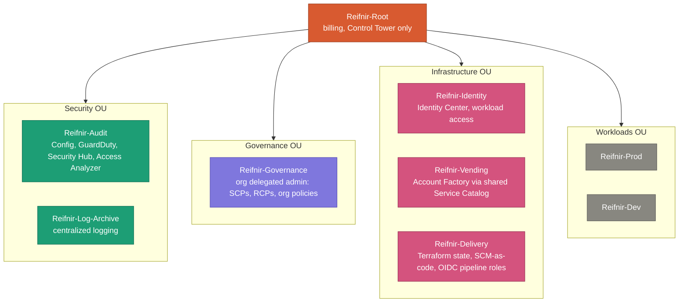

# Reifnir AWS Organization Build-Out Plan

Target architecture: Control Tower landing zone with Reifnir-Root reduced to billing and Control Tower operations only. Every operational power delegated to exactly one member account, with no member account holding two powers that combine into org-admin capability.

## Account and OU layout

| OU | Account | Role / delegated administration |
|---|---|---|
| — (management) | Reifnir-Root | Billing, Control Tower landing zone operations, Identity Center instance (access outside the Workloads OU), Root-owned SCPs, Organizations delegation policy |
| Security OU | Reifnir-Audit | Control Tower Config integration (Config delegated admin, org aggregator); delegated admin: GuardDuty, Security Hub, IAM Access Analyzer |
| Security OU | Reifnir-Log-Archive | Control Tower centralized logging; no delegated admin |
| Governance OU (sole account) | Reifnir-Governance | Organizations delegated admin: SCPs, RCPs, declarative, AI opt-out and tag policies — only policies it created, only on the Infrastructure, Workloads and Policy Staging OUs |
| Infrastructure OU | Reifnir-Identity | IAM Identity Center delegated admin, managed as code; grants access to Workloads accounts only |
| Infrastructure OU | Reifnir-Vending | Account Factory provisioning via shared Service Catalog portfolio; Workloads OUs only |
| Infrastructure OU | Reifnir-Delivery | Terraform control plane: state for SCM and workload stacks, OIDC pipeline access to Workloads accounts only |
| Workloads OU › Prod OU | Reifnir-Prod | Production workloads; no delegated admin |
| Workloads OU › NonProd OU | Reifnir-Dev | Dev/staging workloads; no delegated admin |
| Policy Staging OU | throwaway accounts | Test target for new SCPs/RCPs before they reach Workloads |
| Suspended OU (not registered) | accounts being closed | Holding area for decommissioned accounts |

# Reifnir organization

Legend: orange = management · green = detective security · purple = preventive policy · pink = shared infrastructure · gray = workloads. Policy Staging and Suspended OUs are omitted from the diagram.

Notes:

- The Security OU is Control Tower's service integration OU. Control Tower 4.0 requires all integration accounts to share one parent OU, and accounts placed there that aren't integration accounts get no baseline. That is why Governance gets its own OU, where its SCPs can be the tightest in the org without affecting anything else.
- The landing zone enables only the centralized logging and Config integrations. Control Tower's Security Roles integration is off, so there is no standing `AdministratorAccess` role in every account reachable from one security account. Audit does its job through delegated admin and service-linked roles; people investigate through a SecurityAudit permission set. Turning off Security Roles also means Control Tower doesn't manage Identity Center (Reifnir-Identity does, as code) and Control Tower's Backup integration isn't available.
- Separation of powers: detection (Audit) cannot alter policy; policy (Governance) cannot grant identity and can only change policies it created; identity (Identity) can only grant access to Workloads accounts; vending (Vending) can only create enrolled, governed accounts in the Workloads OUs; delivery (Delivery) provisions machine access to Workloads accounts only and holds no human-identity or account-creation power.
- Root owns the guardrails on the crown-jewel accounts: the deny-by-default SCP on the Governance OU and the access restrictions on Reifnir-Identity. Governance can't modify or detach them because they don't carry its ownership tag.
- Delivery's bootstrap roles are effectively admin of the account they sit in, so they exist only in Workloads accounts. Governance, Identity and Audit each bootstrap their own OIDC provider, pipeline role and state bucket by hand. Whoever can write a stack's state can steer its next apply, so crown-jewel state never lives in Delivery.
- Residual risk: whoever administers Identity Center can reset users' credentials, and I found no IAM action that restricts that per user. Reifnir-Identity is still a crown jewel: access to it is assigned only from Root, to as few people as possible.
- SCPs/RCPs never bind the management account. Root is protected only by root-user lockdown and near-zero use.
- The SCM management project starts first (the immediate pain point) on an interim state backend; its state migrates to Delivery and its access-mapping half activates once the accounts exist.

## Tasks

### 1. Stand up the SCM management project (repos as code) — start now

- [x] Create the Terraform project that declaratively manages GitLab/GitHub: project/repo configuration, mirroring, and branch protection.
- [x] Use an interim state backend for now (GitLab-managed Terraform state, or a temporary bucket) — flag it for migration to Delivery in step 11.
- [x] Authenticate the SCM provider with a GitHub App or short-lived token — no long-lived PAT in provider config. Treat state as secret-grade regardless of backend.
- [x] Import the existing repos into state rather than recreating them; converge their config declaratively.
- [x] Have this project manage its own repo's configuration too — including the branch protection on `main` that the future write-role trust policies will depend on.
- [x] Leave the repo→role access mappings as a stubbed module for now; it activates in step 12 once OIDC providers and roles exist.

### 2. Harden the root users

- [x] Add a software MFA key to Reifnir-Root's root user and order a hardware MFA device.
- [ ] Add a hardware MFA key to Reifnir-Root's root user; stop using it afterward.
- [ ] Before step 3, confirm the root user sign-in and MFA work. It is the break-glass path if Identity Center access breaks during the rebuild.
- [x] Enable centralized root access in IAM (from the management account) so member-account root credentials are removed entirely. Root credentials management and root sessions are both on, so new accounts are created without root credentials.

### 3. Rebuild the landing zone

The first landing zone put Security Roles and Config in Reifnir-Aggregator and centralized logging in Reifnir-Audit. Control Tower treats integration accounts as a one-time selection at setup, and both accounts are nearly empty, so decommission and start fresh.

- [x] Create a Suspended OU. Don't register it with Control Tower.
- [x] Decommission the landing zone from Root (console or `DeleteLandingZone`). It removes Control Tower's SCPs, controls, StackSets and records, and leaves accounts, OUs and data in place. Don't hand-delete Control Tower resources instead; AWS warns that this can block a new landing zone.
- [x] Get into the old accounts through `OrganizationAccountAccessRole` (decommission recreates it) or the existing `AWSAdministratorAccess` group assignment. Keep the Control Tower-created groups until the old accounts are closed (step 8 deletes them).
- [x] Delete the leftover `aws-controltower-*` S3 buckets and CloudWatch log groups in Root, Reifnir-Audit and Reifnir-Aggregator. Control Tower requires this before a new landing zone can be set up.
- [x] Confirm the organization trail `aws-controltower-BaselineCloudTrail` is gone from Root (us-east-1), and delete it if not. It lives in Root but writes to a bucket in the old Reifnir-Audit, so closing that account won't remove it.
- [x] Deregister Reifnir-Aggregator as the AWS Config delegated administrator, then disable AWS Config trusted access for the organization (`config.amazonaws.com`, currently enabled). Control Tower's prerequisites say the organization can't have it enabled at setup.
- [ ] If you want the old root emails back, move them with `aws account start-primary-email-update` from Root while the accounts are still active. Member root users have no credentials, so that's the only way, and a closed account's email can never be reused for Account Factory.
- [ ] Move the old Reifnir-Audit and Reifnir-Aggregator into the Suspended OU and close them. Closed accounts stay listed as CLOSED for up to 90 days.
- [ ] From Root, create the new Reifnir-Log-Archive and Reifnir-Audit accounts in the Security OU (`aws organizations create-account`, then move them). Organizations doesn't document whether account names must be unique; if `Reifnir-Audit` is rejected while the old account is still listed, wait for it to drop off.
- [ ] Confirm the management-account roles the API setup uses still exist: `AWSControlTowerAdmin`, `AWSControlTowerCloudTrailRole`, `AWSControlTowerStackSetRole` and `AWSControlTowerConfigAggregatorRoleForOrganizations` (present today; recreate them if decommission removed them).
- [ ] Set up a new 4.0 landing zone with this manifest: `governedRegions` us-east-1 and us-west-2; `centralizedLogging` → Reifnir-Log-Archive; `config` → Reifnir-Audit; `securityRoles`, `accessManagement` and `backup` disabled. Every `enabled` flag must be stated explicitly.
- [ ] Confirm Control Tower registered Reifnir-Audit as the AWS Config delegated admin with the service-linked aggregator.
- [ ] Confirm the `AWSControlTowerSecurityResources` and `AWSControlTowerBP-BASELINE-ROLES` StackSets are absent or have no instances, so no `aws-controltower-AdministratorExecutionRole` exists anywhere.

### 4. Create and register the OUs

- [ ] From Root, create the Workloads OU with Prod and NonProd child OUs, and the Policy Staging OU. Governance and Infrastructure OUs already exist.
- [ ] Register the Governance, Infrastructure, Workloads, Prod, NonProd and Policy Staging OUs so the Control Tower baseline applies. Suspended stays unregistered.

### 5. Enable controls per OU

- [ ] Apply the strongly-recommended control set to the Governance, Infrastructure, Workloads, Prod, NonProd and Policy Staging OUs. Policy Staging gets the same controls as Workloads so SCP tests there are representative.
- [ ] Apply the tightest posture to the Governance OU (most dangerous account): from Root, attach a deny-by-default SCP that allows only Organizations policy actions, read-only IAM/STS, and logging/Config reads. Exempt `AWSControlTowerExecution`. Add the policy-ownership denies from step 10. Attach it after Governance's pipeline role is bootstrapped. Only Root can change it.
- [ ] Review the Security OU deliberately — it carries mandatory controls by default; decide whether to add electives.

### 6. Provision remaining accounts (last Account Factory run from Root)

With Identity Center self-managed, Account Factory no longer creates Identity Center users or assignments; access is granted in step 8.

- [ ] Reifnir-Governance → Governance OU
- [ ] Reifnir-Identity → Infrastructure OU
- [ ] Reifnir-Vending → Infrastructure OU
- [ ] Reifnir-Delivery → Infrastructure OU
- [ ] Reifnir-Prod → Workloads › Prod OU
- [ ] Reifnir-Dev → Workloads › NonProd OU
- [ ] From Root, assign yourself an admin permission set (user assignment, like the existing `AdministratorAccess` on Root) in Reifnir-Log-Archive, Reifnir-Audit, Reifnir-Governance, Reifnir-Identity, Reifnir-Vending and Reifnir-Delivery. Account Factory doesn't do this any more, and steps 8–11 need it to bootstrap those accounts. Pare it back once each account's pipeline exists.

### 7. Set up the Account Factory portfolio share

- [ ] In Root: create a Service Catalog portfolio containing the Account Factory product.
- [ ] Attach a tightly scoped launch constraint role.
- [ ] Add a template constraint that limits `ManagedOrganizationalUnit` to the Prod, NonProd and Policy Staging OUs. Template constraints carry over to the importing account and it can't remove them.
- [ ] Share the portfolio to Reifnir-Vending.
- [ ] In Vending: import the share. From Root, grant Vending's operators a permission set scoped to Service Catalog actions only.
- [ ] Provisioning from a member account is documented only in an older AWS blog post. Prove it works on Control Tower 4.0 with a throwaway account before relying on it.
- [ ] Note: provisioning must run in the Control Tower home region; re-check the shared product version after every landing zone update.

### 8. Delegate Identity Center to Reifnir-Identity

- [ ] From Root, register Reifnir-Identity as the IAM Identity Center delegated administrator.
- [ ] Bootstrap Identity's own OIDC provider, pipeline role and state bucket by hand. Delivery has no role in this account.
- [ ] Manage permission sets and assignments for Workloads accounts as code from Identity.
- [ ] Root keeps access to everything outside the Workloads OU: permission sets provisioned in the management account (the delegated admin can't alter those) and all assignments to Security, Governance and Infrastructure accounts. Assign users directly, not groups, to management-account permission sets, per AWS guidance.
- [ ] From Root, attach an SCP to Reifnir-Identity that:
  - denies `sso:CreateAccountAssignment`, `sso:DeleteAccountAssignment` and `sso:ProvisionPermissionSet` on every account outside the Workloads OU (`arn:aws:sso:::account/<id>`);
  - denies edits to permission sets tagged `reifnir:owner=root`, and changes to that tag;
  - denies `identitystore:CreateGroupMembership`, `DeleteGroupMembership`, `UpdateUser` and `DeleteUser` on the users and groups that hold access outside the Workloads OU.
- [ ] Recreate the groups and permission sets you need as code, then delete the ones the old landing zone created (`AWSAccountFactory`, `AWSControlTowerAdmins`, `AWSSecurityAuditors`, `AWSSecurityAuditPowerUsers`, `AWSAuditAccountAdmins`, `AWSLogArchive*`, `AWSServiceCatalog*`, and the `AWS*Access` permission sets). Control Tower doesn't remove them.

### 9. Delegate the detective suite to Reifnir-Audit

- [ ] GuardDuty — delegated admin with auto-enable on, in every governed Region (us-east-1 and us-west-2). The designation is per Region.
- [ ] Security Hub — delegated admin with central configuration from us-east-1, linking us-west-2, auto-enabled for all accounts.
- [ ] IAM Access Analyzer — delegated admin, with an organization analyzer in each governed Region.
- [ ] Confirm the Control Tower Config aggregator in Audit is collecting from all accounts.
- [ ] Create a SecurityAudit permission set for investigations, assigned in every account (from Root outside Workloads, from Identity inside).
- [ ] Give Audit read access to CloudTrail logs (Athena over the Log-Archive bucket, CloudTrail Lake or Security Lake). Check it against Control Tower's bucket guardrails.
- [ ] Bootstrap Audit's own OIDC provider, pipeline role and state bucket by hand if its config is managed as code.
- [ ] Optional, later: Inspector, Detective, Macie.

### 10. Delegate policy management to Reifnir-Governance

- [ ] From Root, enable the policy types Governance will manage: RCPs, EC2 declarative policies, AI services opt-out policies and tag policies.
- [ ] Write the Organizations delegation policy in Root. Keep it Allow-only: since June 30, 2026 delegation policies can't use `NotAction` or `NotResource`, and Deny statements aren't documented for them.
  - Allow `Describe*` and `List*`.
  - Allow create, update, delete, tag and untag on policies where `organizations:PolicyType` is `SERVICE_CONTROL_POLICY`, `RESOURCE_CONTROL_POLICY`, `DECLARATIVE_POLICY_EC2`, `AISERVICES_OPT_OUT_POLICY` or `TAG_POLICY`.
  - Allow `AttachPolicy`/`DetachPolicy` only on the explicit ARNs of the Infrastructure, Workloads, Prod, NonProd and Policy Staging OUs. Child OUs aren't included automatically, so add each new OU explicitly. The org root, Security OU, Governance OU, Suspended OU and individual accounts are out of reach.
- [ ] Put the denies in the Root-owned SCP on the Governance OU (step 5), since SCPs apply to delegated administrators:
  - Require the tag `reifnir:policy-owner=governance` on `CreatePolicy` (`aws:RequestTag`).
  - Deny update, delete, attach and detach on any policy without that tag. This covers Control Tower's untagged `aws-guardrails-*` policies, `FullAWSAccess`, and every Root-owned SCP without listing ARNs.
  - Deny `TagResource`/`UntagResource` requests that touch that tag key, so Governance can't adopt policies it didn't create. Test that `CreatePolicy` with tags still works.
- [ ] Test the tag deny on attach and detach. Those calls check both the policy and the target, and AWS doesn't document which one `aws:ResourceTag` is read from. The deny fails closed; if Governance can't attach its own policies, tag the allowed target OUs too, from Root.
- [ ] Bootstrap Governance's own pipeline access and state by hand: a GitHub/GitLab OIDC provider and a single write role whose trust policy uses `StringEquals` to pin the policy repo and `ref:refs/heads/main`, plus a state bucket in Governance. Delivery has no role in this account.
- [ ] Move all custom policy authoring to Governance, trying each new policy on the Policy Staging OU before Workloads.

### 11. Bootstrap Reifnir-Delivery (Terraform control plane)

- [ ] Manually create the state bucket in Delivery: versioned, SSE-KMS with a key held in Delivery, public access blocked, bucket policy restricted to the specific pipeline roles. Use native S3 state locking (Terraform >= 1.10) — no DynamoDB table needed.
- [ ] Structure state by key prefix with separate state files per stack: `scm/`, `accounts/prod/`, `accounts/dev/`, etc., so a mistake in one stack cannot corrupt another. Governance, Identity and Audit state lives in those accounts, not here.
- [ ] Migrate the SCM project's state from the interim backend (step 1) into the `scm/` prefix.
- [ ] Create a bootstrap execution role in each Workloads account only, trusting Reifnir-Delivery and scoped to IAM/OIDC management rather than AdministratorAccess.
- [ ] From Delivery, create the GitHub/GitLab OIDC identity providers in those accounts via Terraform.
- [ ] Document the manual bootstrap steps (bucket, first roles, state migration) — chicken-and-egg is expected here.

### 12. Activate declarative pipeline access (SCM project, phase 2)

- [ ] Un-stub the repo→role access mappings module from step 1. It covers Workloads accounts only; pipeline roles in Governance, Identity and Audit are managed from inside those accounts.
- [ ] Define pipeline role trust policies with OIDC `sub` conditions pinning exact org/repo and ref: write-capable roles require `ref:refs/heads/main`; non-main branches get plan-only roles limited to read plus state locking.
- [ ] Use `StringEquals` on `sub` claims wherever possible; if `StringLike` is unavoidable, never wildcard the org/repo portion (`repo:org/*` grants every repo in the org).
- [ ] Pin the OIDC `aud` claim in addition to `sub`.
- [ ] Verify the branch protection on `main` (managed since step 1) is enforced — the `ref` condition is only as strong as it.

### 13. Shrink Root's remaining surface

- [ ] Activate IAM user and role access to Billing information (root-user account setting); without it a billing permission set can't see billing.
- [ ] Create a billing-only Identity Center permission set for invoice/payment tasks.
- [ ] Set the security, billing and operations alternate contacts for every account from Root (`aws account put-alternate-contact --account-id`), so AWS notices don't go only to the root emails.
- [ ] Enable PDF invoice delivery by email.
- [ ] Set AWS Budgets alerts.
- [ ] Optional: register a Cost Optimization Hub delegated admin for cost visibility outside Root.

### 14. Verify end-to-end

- [ ] Provision a throwaway account from Reifnir-Vending into Policy Staging.
- [ ] Confirm it lands enrolled: CloudTrail, Config, guardrails, GuardDuty membership all active.
- [ ] Confirm Vending **cannot** provision into any OU outside Prod, NonProd and Policy Staging.
- [ ] Confirm Governance can create, attach and edit its own tagged policy on Policy Staging.
- [ ] Confirm Governance **cannot** update, detach or delete a Control Tower guardrail, `FullAWSAccess`, or a Root-owned SCP.
- [ ] Confirm Governance **cannot** attach or detach anything on the org root, Security OU, Governance OU, Suspended OU or an individual account.
- [ ] Confirm Identity **cannot** create an assignment in any account outside the Workloads OU, or edit a `reifnir:owner=root` permission set.
- [ ] Confirm Delivery **cannot** assume any role outside the Workloads OU.
- [ ] Confirm no account has `aws-controltower-AdministratorExecutionRole`.
- [ ] From a non-main branch pipeline, confirm the write-capable role assumption is **denied** and the plan-only role works (including state lock acquisition).
- [ ] From a main-branch pipeline, confirm the write role works and is scoped to only its intended account.
- [ ] Confirm a repo not in the declared access mappings cannot assume any pipeline role.
- [ ] Move the test account to the Suspended OU and close it.

### Later

- [ ] IPAM: deferred until there is real networking to manage. When needed, add a Network account in the Infrastructure OU as IPAM delegated admin (and later Transit Gateway, egress, DNS).
- [ ] Backups: Control Tower's Backup integration requires Security Roles, so if Prod holds data, set up AWS Backup yourself with a delegated admin, backup policies and a cross-account vault.
- [ ] Break-glass: document how to get into member accounts if Identity Center or its users are unavailable (Root's root user, centralized root access for member-account root tasks).

## Steady state

Root should only see logins for billing checks, Control Tower landing zone updates, and access changes outside the Workloads OU, a few times per year, via scoped Identity Center permission sets — never the root user.
