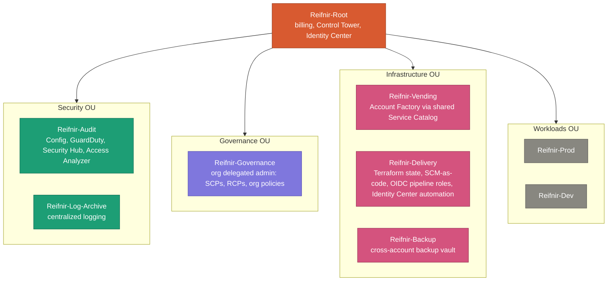

# Reifnir AWS Organization Build-Out Plan

Target architecture: Control Tower landing zone with Reifnir-Root reduced to billing, Control Tower operations and Identity Center administration. Every other operational power delegated to exactly one member account, with no member account holding two powers that combine into org-admin capability.

## Account and OU layout

| OU | Account | Role / delegated administration |
|---|---|---|
| — (management) | Reifnir-Root | Billing, Control Tower landing zone operations, Identity Center instance and administration (not delegated — see [Why Identity Center stays in Root](#why-identity-center-stays-in-root)), Identity Center automation role for Workloads access, Root-owned SCPs, Organizations delegation policy |
| Security OU | Reifnir-Audit | Control Tower Config integration (Config delegated admin, org aggregator); delegated admin: GuardDuty, Security Hub, IAM Access Analyzer |
| Security OU | Reifnir-Log-Archive | Control Tower centralized logging; no delegated admin |
| Governance OU (sole account) | Reifnir-Governance | Organizations delegated admin: SCPs, RCPs, declarative, AI opt-out, tag and backup policies — only policies it created, only on the Infrastructure, Workloads and Policy Staging OUs |
| Infrastructure OU | Reifnir-Vending | Account Factory provisioning via shared Service Catalog portfolio; Workloads OUs only |
| Infrastructure OU | Reifnir-Delivery | Terraform control plane: state for SCM and non-workload stacks, Identity Center automation (Workloads only) through a scoped role in Root, OIDC pipeline access to Workloads accounts only |
| Infrastructure OU | Reifnir-Backup | Cross-account backup vault (Vault Lock) holding copies of Prod backups; no pipeline access |
| Workloads OU › Prod OU | Reifnir-Prod | Production workloads; no delegated admin |
| Workloads OU › NonProd OU | Reifnir-Dev | Dev/staging workloads; no delegated admin |
| Policy Staging OU | throwaway accounts | Test target for new SCPs/RCPs before they reach Workloads |
| Suspended OU (not registered) | accounts being closed | Holding area for decommissioned accounts |

# Reifnir organization



Legend: orange = management · green = detective security · purple = preventive policy · pink = shared infrastructure · gray = workloads. Policy Staging and Suspended OUs are omitted from the diagram.

Notes:

- The Security OU is Control Tower's service integration OU. Control Tower 4.0 requires all integration accounts to share one parent OU, and accounts placed there that aren't integration accounts get no baseline. That is why Governance gets its own OU, where its SCPs can be the tightest in the org without affecting anything else.
- The landing zone enables only the centralized logging and Config integrations. Control Tower's Security Roles integration is off, so there is no standing `AdministratorAccess` role in every account reachable from one security account. Audit does its job through delegated admin and service-linked roles; people investigate through a SecurityAudit permission set. Turning off Security Roles also means Control Tower doesn't manage Identity Center (Root does, as code, through the automation role) and Control Tower's Backup integration isn't available (step 13 sets up backups directly).
- Separation of powers: detection (Audit) cannot alter policy; policy (Governance) cannot grant identity and can only change policies it created; Workloads access (the Identity Center automation role in Root, driven from Delivery) can only manage Delivery-owned permission sets and assignments in an allowlist of Workloads accounts, and can't touch users, credentials or instance settings; vending (Vending) can only create enrolled, governed accounts in the Workloads OUs; delivery (Delivery) provisions machine access to Workloads accounts only and holds no account-creation power; backup custody (Backup) holds locked copies that no Workloads principal can delete.
- Root owns the guardrails on the crown-jewel accounts: the deny-by-default SCP on the Governance OU and the SCP that confines Delivery to Workloads. Governance can't modify or detach them because they don't carry its ownership tag.
- Delivery's bootstrap roles are effectively admin of the account they sit in, so they exist only in Workloads accounts. Governance and Audit each bootstrap their own OIDC provider, pipeline role and state bucket by hand, and the root user creates the Identity Center automation role in Root by hand. Whoever can write a stack's state can steer its next apply, so Governance and Audit state never lives in Delivery.
- AWS trusts OIDC tokens from GitLab only, pinned to exact project paths and `main`. GitHub has no AWS access and no OIDC provider. Security of the GitLab and GitHub accounts themselves is handled outside this project.
- Human access uses two Identity Center users with separate credentials and separate hardware MFA keys. The daily user gets access to Workloads accounts only. The elevated user gets the non-Workloads accounts (Security, Governance, Infrastructure), and only the root user can assign it. Delivery is reachable only by its pipeline roles and the elevated user.
- No Identity Center permission set is provisioned in Root once the bootstrap is done. SCPs/RCPs never bind the management account, so this isn't an SCP. Three things enforce it instead: the automation role can't target Root's account, only the root user can make assignments outside Workloads, and an alert fires on any assignment to Root. Beyond that, Root is protected by root-user lockdown and near-zero use.
- The SCM management project starts first (the immediate pain point) on an interim state backend; its state migrates to Delivery and its access-mapping half activates once the accounts exist.

### Why Identity Center stays in Root

In an org with more than one administrator, Identity Center would be delegated to a dedicated Reifnir-Identity account, so that day-to-day access changes never need a session in the management account. Here, that account would be equivalent to Root without the root user's protections:

- Whoever administers Identity Center can reset the passwords and MFA devices of the users who hold access to Root and the other crown-jewel accounts. They can also change instance-wide settings such as the MFA requirement and the identity source. These actions can't be scoped per user, so a delegated admin account could take over Root.
- With one person, delegation doesn't separate one person's powers from another's. It only adds a second account that has to be protected as carefully as Root.

So Identity Center is administered in Root. The root user manages users, groups and access outside Workloads by hand. A narrowly scoped automation role, driven from Delivery, manages Workloads permission sets and assignments as code (step 11).

How we'd do it with several administrators:

1. Use an external IdP (Entra ID, Okta, Google Workspace, …) as the identity source, so passwords and MFA live outside Identity Center and its administrator can't reset them. Different people administer the IdP and AWS access.
2. Register a dedicated Reifnir-Identity account as the Identity Center delegated administrator. Put it in its own OU, outside Governance's attach scope, so no other delegated admin can affect it. Manage it as code from its own pipeline with its own state; Delivery has no role there.
3. Keep in Root every permission set provisioned to the management account and every assignment to Security, Governance and Infrastructure accounts. The delegated admin can't alter management-account permission sets. Assign users directly, not groups, to those permission sets, because the delegated admin can change group membership.
4. From Root, attach an SCP to Reifnir-Identity that:
   - denies `sso:CreateAccountAssignment`, `sso:DeleteAccountAssignment` and `sso:ProvisionPermissionSet` with `NotResource` listing the Workloads account ARNs (`arn:aws:sso:::account/<id>`). It fails closed: a new account is out of reach until Root adds it;
   - denies edits to permission sets tagged `reifnir:owner=root`, and changes to that tag;
   - denies identity store writes (`UpdateUser`, `DeleteUser`, `CreateGroupMembership`, `DeleteGroupMembership`) on the users and groups that hold access outside Workloads;
   - denies outright the actions that reset credentials, remove MFA devices or change instance settings (identity source, MFA policy, attributes for access control, trusted token issuers), since they can't be scoped per user. Root handles those.
5. Require a second person's approval on the Identity repo's `main`, so no single administrator can change access alone.

## Tasks

### 1. Stand up the SCM management project (repos as code) — start now

- [x] Create the Terraform project that declaratively manages GitLab/GitHub: project/repo configuration, mirroring, and branch protection.
- [x] Use an interim state backend for now (GitLab-managed Terraform state, or a temporary bucket) — flag it for migration to Delivery in step 11.
- [x] Authenticate the SCM provider with a GitHub App or short-lived token — no long-lived PAT in provider config. Treat state as secret-grade regardless of backend.
- [x] Import the existing repos into state rather than recreating them; converge their config declaratively.
- [x] Have this project manage its own repo's configuration too — including the branch protection on `main` that the future write-role trust policies will depend on.
- [x] Leave the repo→role access mappings as a stubbed module for now; it activates in step 12 once OIDC providers and roles exist.

### 2. Harden the root users

- [x] Add a software MFA key to Reifnir-Root's root user and order a hardware MFA device.
- [x] Add a hardware MFA key to Reifnir-Root's root user; stop using it afterward.
- [x] Before step 3, confirm the root user sign-in and MFA work. It is the break-glass path if Identity Center access breaks during the rebuild.
- [x] Enable centralized root access in IAM (from the management account) so member-account root credentials are removed entirely. Root credentials management and root sessions are both on, so new accounts are created without root credentials.

### 3. Rebuild the landing zone

The first landing zone put Security Roles and Config in Reifnir-Aggregator and centralized logging in Reifnir-Audit. Control Tower treats integration accounts as a one-time selection at setup, and both accounts are nearly empty, so decommission and start fresh.

- [x] Create a Suspended OU. Don't register it with Control Tower.
- [x] Decommission the landing zone from Root (console or `DeleteLandingZone`). It removes Control Tower's SCPs, controls, StackSets and records, and leaves accounts, OUs and data in place. Don't hand-delete Control Tower resources instead; AWS warns that this can block a new landing zone.
- [x] Get into the old accounts through `OrganizationAccountAccessRole` (decommission recreates it) or the existing `AWSAdministratorAccess` group assignment. Keep the Control Tower-created groups until the old accounts are closed (step 8 deletes them).
- [x] Delete the leftover `aws-controltower-*` S3 buckets and CloudWatch log groups in Root, Reifnir-Audit and Reifnir-Aggregator. Control Tower requires this before a new landing zone can be set up.
- [x] Confirm the organization trail `aws-controltower-BaselineCloudTrail` is gone from Root (us-east-1), and delete it if not. It lives in Root but writes to a bucket in the old Reifnir-Audit, so closing that account won't remove it.
- [x] Deregister Reifnir-Aggregator as the AWS Config delegated administrator, then disable AWS Config trusted access for the organization (`config.amazonaws.com`, currently enabled). Control Tower's prerequisites say the organization can't have it enabled at setup.
- [x] Move the old Reifnir-Audit and Reifnir-Aggregator into the Suspended OU and close them. Closed accounts stay listed as CLOSED for up to 90 days.
- [ ] From Root, create the new Reifnir-Log-Archive and Reifnir-Audit accounts in the Security OU (`aws organizations create-account`, then move them). Organizations doesn't document whether account names must be unique; if `Reifnir-Audit` is rejected while the old account is still listed, wait for it to drop off.
- [x] Confirm the management-account roles the API setup uses still exist: `AWSControlTowerAdmin`, `AWSControlTowerCloudTrailRole`, `AWSControlTowerStackSetRole` and `AWSControlTowerConfigAggregatorRoleForOrganizations` (present today; recreate them if decommission removed them).
- [ ] Set up a new 4.0 landing zone with this manifest: `governedRegions` us-east-1 and us-west-2; `centralizedLogging` → Reifnir-Log-Archive; `config` → Reifnir-Audit; `securityRoles`, `accessManagement` and `backup` disabled. Every `enabled` flag must be stated explicitly.
- [ ] Confirm Control Tower registered Reifnir-Audit as the AWS Config delegated admin with the service-linked aggregator.
- [ ] Confirm the `AWSControlTowerSecurityResources` and `AWSControlTowerBP-BASELINE-ROLES` StackSets are absent or have no instances, so no `aws-controltower-AdministratorExecutionRole` exists anywhere.

### 4. Create and register the OUs

- [ ] From Root, create the Workloads OU with Prod and NonProd child OUs, and the Policy Staging OU. Governance and Infrastructure OUs already exist.
- [ ] Register the Governance, Infrastructure, Workloads, Prod, NonProd and Policy Staging OUs so the Control Tower baseline applies. Suspended stays unregistered.

### 5. Enable controls per OU

- [ ] Apply the strongly-recommended control set to the Governance, Infrastructure, Workloads, Prod, NonProd and Policy Staging OUs. Policy Staging gets the same controls as Workloads so SCP tests there are representative.
- [ ] Apply the tightest posture to the Governance OU (most dangerous account): from Root, attach a deny-by-default SCP that allows only Organizations policy actions, read-only IAM/STS, and logging/Config reads. Exempt `AWSControlTowerExecution`. Add the policy-ownership denies from step 10. Attach it after Governance's pipeline role is bootstrapped. Only Root can change it.
- [ ] Review the Security OU deliberately — it carries mandatory controls by default; decide whether to add electives.

### 6. Provision remaining accounts (last Account Factory run from Root)

With Identity Center self-managed, Account Factory no longer creates Identity Center users or assignments; access is granted in step 8.

- [ ] Reifnir-Governance → Governance OU
- [ ] Reifnir-Vending → Infrastructure OU
- [ ] Reifnir-Delivery → Infrastructure OU
- [ ] Reifnir-Backup → Infrastructure OU
- [ ] Reifnir-Prod → Workloads › Prod OU
- [ ] Reifnir-Dev → Workloads › NonProd OU
- [ ] From Root, create the elevated Identity Center user: a separate username, password and hardware MFA key from the daily user, used only for non-Workloads accounts.
- [ ] From Root, assign the elevated user an admin permission set (user assignment, not group) in Reifnir-Log-Archive, Reifnir-Audit, Reifnir-Governance, Reifnir-Vending, Reifnir-Delivery and Reifnir-Backup. Account Factory doesn't do this any more, and steps 8–13 need it to bootstrap those accounts. Pare it back once each account's pipeline exists.

### 7. Set up the Account Factory portfolio share

- [ ] In Root: create a Service Catalog portfolio containing the Account Factory product.
- [ ] Attach a tightly scoped launch constraint role.
- [ ] Add a template constraint that limits `ManagedOrganizationalUnit` to the Prod, NonProd and Policy Staging OUs. Template constraints carry over to the importing account and it can't remove them.
- [ ] Share the portfolio to Reifnir-Vending.
- [ ] In Vending: import the share. From Root, grant Vending's operators a permission set scoped to Service Catalog actions only.
- [ ] Provisioning from a member account is documented only in an older AWS blog post. Prove it works on Control Tower 4.0 with a throwaway account before relying on it.
- [ ] Note: provisioning must run in the Control Tower home region; re-check the shared product version after every landing zone update.

### 8. Keep Identity Center in Root; set up break-glass

Don't register an Identity Center delegated administrator (see [Why Identity Center stays in Root](#why-identity-center-stays-in-root)). The Workloads automation is built in step 11, once Delivery exists.

- [ ] Users and groups are few and rarely change: the root user manages them by hand. No automation gets identity store write access.
- [ ] The root user makes every assignment outside the Workloads OU (Security, Governance, Infrastructure and Policy Staging accounts), to the elevated user only.
- [ ] Recreate the groups and permission sets you need (Workloads ones as code once step 11 is done), then delete the ones the old landing zone created (`AWSAccountFactory`, `AWSControlTowerAdmins`, `AWSSecurityAuditors`, `AWSSecurityAuditPowerUsers`, `AWSAuditAccountAdmins`, `AWSLogArchive*`, `AWSServiceCatalog*`, and the `AWS*Access` permission sets). Control Tower doesn't remove them.
- [ ] Alerts, from an EventBridge rule in Root to an email/SNS target, in Identity Center's home Region and us-east-1 for sign-in events:
  - root-user sign-in to Root;
  - `CreateAccountAssignment` or `ProvisionPermissionSet` targeting Root's account ID (no permission set should ever be provisioned there after step 11);
  - any `AccessDenied` for the Identity Center automation role (step 11), which means something tried to step outside its scope.

Break-glass is still needed with Identity Center in Root. Once no permission set is provisioned in Root, the root user becomes the normal way into Root. Break-glass then covers getting into member accounts when Identity Center can't be used: an Identity Center outage in its home Region, a bad apply that removes assignments, or a lost elevated-user MFA key. It also covers resources locked by their own policies.

- [ ] Register a second hardware MFA key on Root's root user and store it apart from the first (the root user supports up to eight MFA devices). Losing the only key would otherwise mean AWS's account recovery process.
- [ ] Protect the root user's email inbox with MFA: it is the root user's password-reset path, so it is as sensitive as the root user itself.
- [ ] Write the runbook:
  1. Sign in to Root as the root user.
  2. Get into a member account by assuming `AWSControlTowerExecution` (Account Factory–enrolled accounts) or `OrganizationAccountAccessRole` (accounts made with `create-account`). Record which role each account has. Governance's SCP exempts `AWSControlTowerExecution`, so this path works there too.
  3. For tasks that need member-account root (unlocking an S3 bucket or SQS queue policy that denies everyone, for example), use `sts:AssumeRoot` from Root through centralized root access.
  4. Afterwards, check the alert fired, review CloudTrail for the session, and repair Identity Center through the normal path.
- [ ] Test the runbook end to end before removing `AdministratorAccess` on Root (step 11), then twice a year.

### 9. Delegate the detective suite to Reifnir-Audit

- [ ] GuardDuty — delegated admin with auto-enable on, in every governed Region (us-east-1 and us-west-2). The designation is per Region.
- [ ] Security Hub — delegated admin with central configuration from us-east-1, linking us-west-2, auto-enabled for all accounts.
- [ ] IAM Access Analyzer — delegated admin, with an organization analyzer in each governed Region.
- [ ] Confirm the Control Tower Config aggregator in Audit is collecting from all accounts.
- [ ] Create a SecurityAudit permission set for investigations, assigned in every account (by the root user outside Workloads, by the Identity Center pipeline inside).
- [ ] Give Audit read access to CloudTrail logs (Athena over the Log-Archive bucket, CloudTrail Lake or Security Lake). Check it against Control Tower's bucket guardrails.
- [ ] Bootstrap Audit's own OIDC provider, pipeline role and state bucket by hand if its config is managed as code.
- [ ] Optional, later: Inspector, Detective, Macie.

### 10. Delegate policy management to Reifnir-Governance

- [ ] From Root, enable the policy types Governance will manage: RCPs, EC2 declarative policies, AI services opt-out policies, tag policies and backup policies.
- [ ] Write the Organizations delegation policy in Root. Keep it Allow-only: since June 30, 2026 delegation policies can't use `NotAction` or `NotResource`, and Deny statements aren't documented for them.
  - Allow `Describe*` and `List*`.
  - Allow create, update, delete, tag and untag on policies where `organizations:PolicyType` is `SERVICE_CONTROL_POLICY`, `RESOURCE_CONTROL_POLICY`, `DECLARATIVE_POLICY_EC2`, `AISERVICES_OPT_OUT_POLICY`, `TAG_POLICY` or `BACKUP_POLICY`.
  - Allow `AttachPolicy`/`DetachPolicy` only on the explicit ARNs of the Infrastructure, Workloads, Prod, NonProd and Policy Staging OUs. Child OUs aren't included automatically, so add each new OU explicitly. The org root, Security OU, Governance OU, Suspended OU and individual accounts are out of reach.
- [ ] Put the denies in the Root-owned SCP on the Governance OU (step 5), since SCPs apply to delegated administrators:
  - Require the tag `reifnir:policy-owner=governance` on `CreatePolicy` (`aws:RequestTag`).
  - Deny update, delete, attach and detach on any policy without that tag. This covers Control Tower's untagged `aws-guardrails-*` policies, `FullAWSAccess`, and every Root-owned SCP without listing ARNs.
  - Deny `TagResource`/`UntagResource` requests that touch that tag key, so Governance can't adopt policies it didn't create. Test that `CreatePolicy` with tags still works.
- [ ] Test the tag deny on attach and detach. Those calls check both the policy and the target, and AWS doesn't document which one `aws:ResourceTag` is read from. The deny fails closed; if Governance can't attach its own policies, tag the allowed target OUs too, from Root.
- [ ] Bootstrap Governance's own pipeline access and state by hand: a GitLab OIDC provider and a single write role whose trust policy uses `StringEquals` to pin `sub` to the policy project's path and `main`, plus a state bucket in Governance. Delivery has no role in this account.
- [ ] Move all custom policy authoring to Governance, trying each new policy on the Policy Staging OU before Workloads.

### 11. Bootstrap Reifnir-Delivery (Terraform control plane)

- [ ] Manually create the state buckets in Delivery, each versioned, SSE-KMS with its own key held in Delivery, public access blocked, and a bucket policy that admits only that bucket's pipeline roles. Use native S3 state locking (Terraform >= 1.10) — no DynamoDB table needed.
  - A management bucket for the non-workload stacks: `scm/`, `identity-center/`.
  - A Prod bucket and a Dev bucket, one state file per stack inside each, so neither environment's roles can reach the other's state.
  - Governance and Audit state lives in those accounts, not here.
- [ ] Migrate the SCM project's state from the interim backend (step 1) into the management bucket's `scm/` prefix.
- [ ] Create a bootstrap execution role in each Workloads account only, trusting Reifnir-Delivery and scoped to IAM/OIDC management rather than AdministratorAccess.
- [ ] From Delivery, create the GitLab OIDC identity provider in those accounts via Terraform.
- [ ] Delivery's human access is the elevated user only, assigned by the root user. The daily user gets no assignment in Delivery.
- [ ] From Root, attach an SCP directly to the Reifnir-Delivery account. It is untagged, so Governance can't touch it. It confines Delivery's role assumption to the Workloads OU, Delivery itself, and the Identity Center automation role in Root:

  ```json
  {
    "Sid": "DeliveryAssumesOnlyWorkloadsRoles",
    "Effect": "Deny",
    "Action": ["sts:AssumeRole", "sts:TagSession", "sts:SetSourceIdentity"],
    "NotResource": "arn:aws:iam::<root-account-id>:role/reifnir-identity-center-automation",
    "Condition": {
      "ForAllValues:StringNotLike": { "aws:ResourceOrgPaths": "<org-id>/<root-id>/<workloads-ou-id>/*" },
      "StringNotEquals": { "aws:ResourceAccount": "<delivery-account-id>" }
    }
  }
  ```

- [ ] From Root (root user), create the Identity Center automation role `reifnir-identity-center-automation` in Root, by hand:
  - Trust only Delivery's Identity Center pipeline role (`aws:PrincipalArn` pinned to its ARN); maximum session duration one hour.
  - Allow-only policy, one statement per resource type, because an assignment call is authorized against the instance, the permission set and the target account separately:
    - read: `sso:Describe*`, `sso:List*`, `sso:Get*`, identity store `Describe*`/`List*`/`GetUserId`/`GetGroupId`, `organizations:ListAccounts`/`DescribeAccount`;
    - `sso:CreatePermissionSet` only with request tag `reifnir:owner=delivery`; update, delete, policy attach/detach/put and provisioning only on permission sets tagged `reifnir:owner=delivery`; no tag changes to `reifnir:owner` after creation;
    - `sso:CreateAccountAssignment`, `sso:DeleteAccountAssignment` and `sso:ProvisionPermissionSet` only on an explicit allowlist of Workloads account ARNs (`arn:aws:sso:::account/<id>`). This fails closed: a newly vended account is out of reach until the root user adds it.
  - Grant nothing else: no identity store writes, no credential or MFA actions, no instance settings (identity source, MFA policy, attributes for access control, applications, trusted token issuers), no IAM, and never Root's own account ID.
  - Only the root user edits this role; Delivery can't modify it.
- [ ] In Delivery, create the Identity Center pipeline role, trusting OIDC pinned with `StringEquals` to the Identity Center project's path and `main`. It may assume only the automation role and use the `identity-center/` state prefix.
- [ ] Manage Workloads permission sets and assignments as code from that pipeline (daily user, SecurityAudit inside Workloads).
- [ ] Once the break-glass runbook passes (step 8) and no Terraform state is left in Root, remove the `AdministratorAccess` assignment on Root. From then on no permission set is provisioned in Root.
- [ ] Document the manual bootstrap steps (buckets, first roles, automation role, state migration) — chicken-and-egg is expected here.

### 12. Activate declarative pipeline access (SCM project, phase 2)

- [ ] Un-stub the repo→role access mappings module from step 1. It covers Workloads accounts only; pipeline roles in Governance and Audit are managed from inside those accounts, and the Identity Center automation role in Root by the root user.
- [ ] Define pipeline role trust policies with OIDC `sub` conditions pinning the exact GitLab project path and ref. GitLab's `sub` has the form `project_path:<group>/<project>:ref_type:branch:ref:<branch>`; write-capable roles require `ref_type:branch:ref:main`.
- [ ] Plan-only roles for non-main branches (read plus state locking) are deferred while I'm the only person who can push. **Create them before anyone else gets push access to any mapped repo.**
- [ ] Use `StringEquals` on `sub` claims wherever possible; if `StringLike` is unavoidable, never wildcard the group/project portion (`project_path:<group>/*` grants every project in the group).
- [ ] Pin the OIDC `aud` claim in addition to `sub`.
- [ ] Verify the branch protection on `main` (managed since step 1) is enforced — the `ref` condition is only as strong as it.

Alert on every assumption of a crown-jewel role. These are rare, so each alert should match a merge or a break-glass session of your own.

- [ ] Crown-jewel roles:
  - Root: `reifnir-identity-center-automation` and the Account Factory launch constraint role (step 7);
  - Governance: the policy write role;
  - Audit: the pipeline role;
  - Delivery: the SCM pipeline role, the Identity Center pipeline role, and any role that can write the management state bucket;
  - Prod: the Delivery bootstrap execution role and the write-capable pipeline roles;
  - every account: `OrganizationAccountAccessRole`, and `AWSControlTowerExecution` when the caller isn't one of Control Tower's own roles (break-glass use, step 8).
- [ ] In each account that owns one of those roles, create an EventBridge rule `reifnir-alert-role-assumption` matching CloudTrail `AssumeRole` and `AssumeRoleWithWebIdentity` events (`source: aws.sts`) whose `requestParameters.roleArn` is one of that account's crown-jewel roles. Deploy it in every enabled Region, not only the governed ones. STS answers in all of them, Control Tower's Region deny control doesn't block it, and each event is logged in the Region whose endpoint was called.
- [ ] Send matches to an event bus in Root, whose policy allows `events:PutEvents` only with `aws:PrincipalOrgID`. Root forwards them to the same SNS/email target as the step 8 alerts. The bus is in Root, not Audit, so a compromised Audit can't silence it.
- [ ] Deploy the member-account rules from Root as a self-managed StackSet executed through `AWSControlTowerExecution`, the only role Governance's deny-by-default SCP lets through.
- [ ] From Root, attach an SCP at the organization root that denies changes to `reifnir-alert-*` rules, their targets and their cross-account IAM role (`events:PutRule`, `DeleteRule`, `DisableRule`, `PutTargets`, `RemoveTargets`, and IAM writes on the role) to everyone except `AWSControlTowerExecution`. It is untagged, so Governance can't detach it. Without it, Delivery's bootstrap role in Prod could delete Prod's rule; even then, the assumption before the deletion would still alert.
- [ ] Set the role session name in every pipeline to the GitLab project and pipeline IDs (for example `gl-<project-id>-<pipeline-id>`), so each alert names the pipeline that caused it. Web-identity alerts also carry the token's `sub`.

### 13. Back up Prod to a separate account

Control Tower's Backup integration needs Security Roles, so backups are set up directly. Delivery's bootstrap role is effectively admin of Prod, so copies have to live where no Prod or Delivery principal can delete them.

- [ ] From Root, enable trusted access for AWS Backup and turn on cross-account backup in Backup's settings.
- [ ] In Reifnir-Backup, create a backup vault with its own customer-managed KMS key. Its vault access policy allows `backup:CopyIntoBackupVault` only from the Prod account.
- [ ] Apply Vault Lock to that vault: governance mode first while retention settings are proven, then compliance mode. Once its cooling-off period ends, compliance mode can't be removed by anyone, Root included. (Alternative: a logically air-gapped vault in Reifnir-Backup.)
- [ ] In Prod, encrypt backed-up resources with customer-managed KMS keys whose policies let the copy work. Resources encrypted with AWS-managed keys (EBS, RDS and others whose backups use the source key) can't be copied to another account.
- [ ] From Governance, write a backup policy (Organizations `BACKUP_POLICY`) for the Prod OU: a backup plan into Prod's local vault plus a copy action to the Reifnir-Backup vault. Prod admins can't edit or remove a policy-managed plan.
- [ ] Delivery and Workloads principals get no role in Reifnir-Backup. Only the elevated user has access, assigned by the root user.
- [ ] Optional: register Reifnir-Backup as the AWS Backup delegated administrator for cross-account job monitoring.
- [ ] Restore test: copy a recovery point back from the Reifnir-Backup vault, restore it and check the data. Repeat at least yearly.

### 14. Shrink Root's remaining surface

- [ ] Billing, like Control Tower landing zone updates, is a root-user task, since no permission set is provisioned in Root. Leave IAM access to Billing information off unless a non-root billing path is added later.
- [ ] Set the security, billing and operations alternate contacts for every account from Root (`aws account put-alternate-contact --account-id`), so AWS notices don't go only to the root emails.
- [ ] Enable PDF invoice delivery by email.
- [ ] Set AWS Budgets alerts.
- [ ] Optional: register a Cost Optimization Hub delegated admin for cost visibility outside Root.

### 15. Verify end-to-end

- [ ] Provision a throwaway account from Reifnir-Vending into Policy Staging.
- [ ] Confirm it lands enrolled: CloudTrail, Config, guardrails, GuardDuty membership all active.
- [ ] Confirm Vending **cannot** provision into any OU outside Prod, NonProd and Policy Staging.
- [ ] Confirm Governance can create, attach and edit its own tagged policy on Policy Staging.
- [ ] Confirm Governance **cannot** update, detach or delete a Control Tower guardrail, `FullAWSAccess`, or a Root-owned SCP.
- [ ] Confirm Governance **cannot** attach or detach anything on the org root, Security OU, Governance OU, Suspended OU or an individual account.
- [ ] Confirm the Identity Center automation role **cannot** create an assignment in an account outside its allowlist (including Root and the throwaway account), edit a permission set not tagged `reifnir:owner=delivery`, update a user, or change an instance setting — and that each attempt raises the alert.
- [ ] Confirm no permission set is provisioned in Root.
- [ ] Confirm Delivery **cannot** assume any role outside the Workloads OU other than the Identity Center automation role.
- [ ] Confirm the Dev pipeline roles **cannot** read or write the Prod state bucket, and vice versa.
- [ ] Confirm no account has `aws-controltower-AdministratorExecutionRole`.
- [ ] From a non-main branch pipeline, confirm the write-capable role assumption is **denied**. Once plan-only roles exist (step 12), confirm they work, including state lock acquisition.
- [ ] From a main-branch pipeline, confirm the write role works and is scoped to only its intended account.
- [ ] Confirm a repo not in the declared access mappings cannot assume any pipeline role.
- [ ] Assume each crown-jewel role once (a normal pipeline run is enough) and confirm the alert arrives in Root with the pipeline's session name. Try the same from an ungoverned Region's STS endpoint.
- [ ] Confirm Delivery's bootstrap role in Prod **cannot** delete or disable Prod's `reifnir-alert-role-assumption` rule.
- [ ] Confirm a Prod recovery point lands in the Reifnir-Backup vault and can't be deleted from Prod or from Backup.
- [ ] Move the test account to the Suspended OU and close it.

### Later

- [ ] IPAM: deferred until there is real networking to manage. When needed, add a Network account in the Infrastructure OU as IPAM delegated admin (and later Transit Gateway, egress, DNS).

## Steady state

Root should see root-user sign-ins only for billing checks, Control Tower landing zone updates and access changes outside the Workloads OU — a few times per year, each one raising an alert. No Identity Center permission set is provisioned in Root. The only other principal acting there is the Identity Center automation role, and only on Workloads permission sets and assignments.
