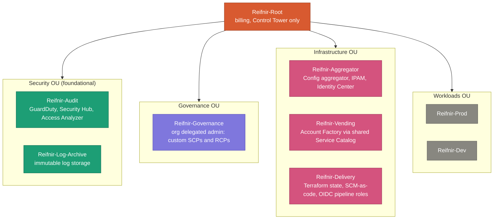

# Reifnir AWS Organization Build-Out Plan

Target architecture: Control Tower landing zone with Reifnir-Root reduced to billing and Control Tower operations only. Every operational power delegated to exactly one member account, with no member account holding two powers that combine into org-admin capability.

## Account and OU layout

| OU | Account | Role / delegated administration |
|---|---|---|
| — (management) | Reifnir-Root | Billing, Control Tower landing zone operations only |
| Security OU (foundational) | Reifnir-Audit | Delegated admin: GuardDuty, Security Hub, IAM Access Analyzer (detective only) |
| Security OU (foundational) | Reifnir-Log-Archive | Immutable log storage; no delegated admin |
| Governance OU | Reifnir-Governance | Organizations delegated admin: custom SCPs and RCPs only |
| Infrastructure OU | Reifnir-Aggregator | Delegated admin: AWS Config aggregator, IPAM, IAM Identity Center |
| Infrastructure OU | Reifnir-Vending | Account Factory provisioning via shared Service Catalog portfolio |
| Infrastructure OU | Reifnir-Delivery | Terraform control plane: state backend, SCM-as-code, automation pipeline access provisioning (through OIDC) |
| Workloads OU | Reifnir-Prod | Production workloads; no delegated admin |
| Workloads OU | Reifnir-Dev | Dev/staging workloads; no delegated admin |

# Reifnir organization

Legend: orange = management · green = detective security · purple = preventive policy · pink = shared infrastructure · gray = workloads

Notes:

- The Security OU is Control Tower's foundational OU. It holds only the two shared accounts — Account Factory cannot provision into it, which is why Governance gets its own OU.
- Separation of powers: detection (Audit) cannot alter policy; policy (Governance) cannot grant identity; identity (Aggregator) cannot loosen guardrails; vending (Vending) can only create enrolled, governed accounts; delivery (Delivery) provisions machine access but holds no human-identity or account-creation power.
- Delivery's bootstrap execution roles in member accounts are crown-jewel credentials — scoped to IAM/OIDC management, not AdministratorAccess, and watched by Audit like everything else.
- SCPs/RCPs never bind the management account. Root is protected only by root-user lockdown and near-zero use.
- The SCM management project starts first (the immediate pain point) on an interim state backend; its state migrates to Delivery and its access-mapping half activates once the accounts exist.

## Tasks

### 1. Stand up the SCM management project (repos as code) — start now

- [x] Create the Terraform project that declaratively manages GitLab/GitHub: project/repo configuration, mirroring, and branch protection.
- [x] Use an interim state backend for now (GitLab-managed Terraform state, or a temporary bucket) — flag it for migration to Delivery in step 12.
- [x] Authenticate the SCM provider with a GitHub App or short-lived token — no long-lived PAT in provider config. Treat state as secret-grade regardless of backend.
- [x] Import the existing repos into state rather than recreating them; converge their config declaratively.
- [x] Have this project manage its own repo's configuration too — including the branch protection on `main` that the future write-role trust policies will depend on.
- [x] Leave the repo→role access mappings as a stubbed module for now; it activates in step 13 once OIDC providers and roles exist.

### 2. Harden the root users

- [x] Add a software MFA key to Reifnir-Root's root user and order a hardware MFA device.
- [ ] Add a hardware MFA key to Reifnir-Root's root user; stop using it afterward.
- [ ] Enable centralized root access in IAM (from the management account) so member-account root credentials are removed entirely.

### 3. Create and register the OUs

- [ ] In Control Tower from Root, create: Governance OU, Infrastructure OU (if not already present), Workloads OU.
- [ ] Register each OU so the Control Tower baseline applies.

### 4. Enable controls per OU

- [ ] Apply the strongly-recommended control set to Governance, Infrastructure, and Workloads OUs.
- [ ] Apply the tightest posture to the Governance OU (most dangerous account).
- [ ] Review the Security OU deliberately — it carries mandatory controls by default; decide whether to add electives.

### 5. Provision remaining accounts (last Account Factory run from Root)

- [ ] Reifnir-Governance → Governance OU
- [ ] Reifnir-Vending → Infrastructure OU
- [ ] Reifnir-Delivery → Infrastructure OU
- [ ] Reifnir-Prod → Workloads OU (if not yet created)
- [ ] Reifnir-Dev → Workloads OU (if not yet created)

### 6. Set up the Account Factory portfolio share

- [ ] In Root: create a Service Catalog portfolio containing the Account Factory product.
- [ ] Attach a tightly scoped launch constraint role.
- [ ] Share the portfolio to Reifnir-Vending.
- [ ] In Vending: import the share and grant the Identity Center principal access.
- [ ] Scope Vending's permission set to Service Catalog actions only.
- [ ] Note: provisioning must run in the Control Tower home region; re-check the shared product version after every landing zone update.

### 7. Delegate Identity Center to Reifnir-Aggregator

- [ ] Register Aggregator as the IAM Identity Center delegated administrator.
- [ ] Limitation to remember: permission sets provisioned into Root itself must still be managed from Root.

### 8. Confirm Config delegation to Aggregator

- [ ] Verify the delegated admin registration for AWS Config.
- [ ] Confirm the org-wide aggregator is collecting from all accounts (Control Tower may have wired part of this at setup).

### 9. Enable IPAM with Aggregator as delegated admin

- [ ] Check whether the Free tier suffices before enabling Advanced (Advanced bills per active IP per hour).
- [ ] Register Aggregator as IPAM delegated administrator.
- [ ] Create the top-level pool and regional pools.
- [ ] RAM-share the pools to Prod and Dev.

### 10. Delegate the detective suite to Reifnir-Audit

- [ ] GuardDuty — delegated admin with auto-enable on.
- [ ] Security Hub — delegated admin with auto-enable on.
- [ ] IAM Access Analyzer — delegated admin.
- [ ] Optional, later: Inspector, Detective, Macie.

### 11. Delegate policy management to Reifnir-Governance

- [ ] Write the Organizations delegation resource policy: allow policy create/update/delete/attach/detach conditioned on policy types `SERVICE_CONTROL_POLICY` and `RESOURCE_CONTROL_POLICY`.
- [ ] Explicitly exclude Control Tower's `aws-guardrails-*` managed policies and `FullAWSAccess` / `RCPFullAWSAccess`.
- [ ] Move all custom SCP/RCP authoring to Governance.

### 12. Bootstrap Reifnir-Delivery (Terraform control plane)

- [ ] Manually create the global state bucket in Delivery: versioned, SSE-KMS with a key held in Delivery, public access blocked, bucket policy restricted to the specific pipeline roles. Use native S3 state locking (Terraform >= 1.10) — no DynamoDB table needed.
- [ ] Structure state by key prefix with separate state files per stack: `org/`, `scm/`, `accounts/prod/`, `accounts/dev/`, etc., so a mistake in one stack cannot corrupt another.
- [ ] Migrate the SCM project's state from the interim backend (step 1) into the `scm/` prefix.
- [ ] Create a bootstrap execution role in each member account that trusts Reifnir-Delivery, scoped to IAM/OIDC management rather than AdministratorAccess.
- [ ] From Delivery, create the GitHub/GitLab OIDC identity providers in each target account via Terraform.
- [ ] Document the manual bootstrap steps (bucket, first roles, state migration) — chicken-and-egg is expected here.

### 13. Activate declarative pipeline access (SCM project, phase 2)

- [ ] Un-stub the repo→role access mappings module from step 1.
- [ ] Define pipeline role trust policies with OIDC `sub` conditions pinning exact org/repo and ref: write-capable roles require `ref:refs/heads/main`; non-main branches get plan-only roles limited to read plus state locking.
- [ ] Use `StringEquals` on `sub` claims wherever possible; if `StringLike` is unavoidable, never wildcard the org/repo portion (`repo:org/*` grants every repo in the org).
- [ ] Pin the OIDC `aud` claim in addition to `sub`.
- [ ] Verify the branch protection on `main` (managed since step 1) is enforced — the `ref` condition is only as strong as it.

### 14. Shrink Root's remaining surface

- [ ] Create a billing-only Identity Center permission set for invoice/payment tasks.
- [ ] Enable PDF invoice delivery by email.
- [ ] Set AWS Budgets alerts.
- [ ] Optional: register a Cost Optimization Hub delegated admin for cost visibility outside Root.

### 15. Verify end-to-end

- [ ] Provision a throwaway account from Reifnir-Vending.
- [ ] Confirm it lands enrolled: CloudTrail, Config, guardrails, GuardDuty membership all active.
- [ ] Confirm Governance can edit a custom SCP and **cannot** touch a Control Tower guardrail.
- [ ] From a non-main branch pipeline, confirm the write-capable role assumption is **denied** and the plan-only role works (including state lock acquisition).
- [ ] From a main-branch pipeline, confirm the write role works and is scoped to only its intended account.
- [ ] Confirm a repo not in the declared access mappings cannot assume any pipeline role.
- [ ] Close the test account.

## Steady state

Root should only see logins for billing checks and Control Tower landing zone updates, a few times per year, via scoped Identity Center permission sets — never the root user.
